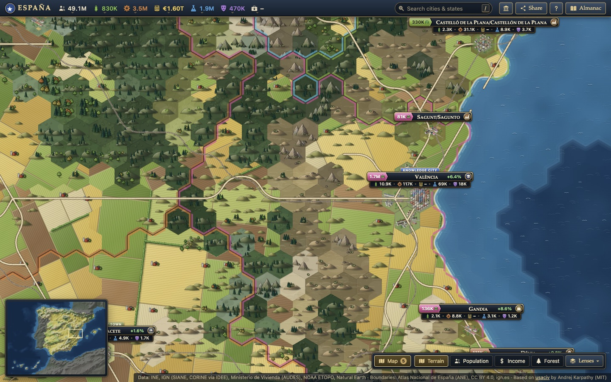
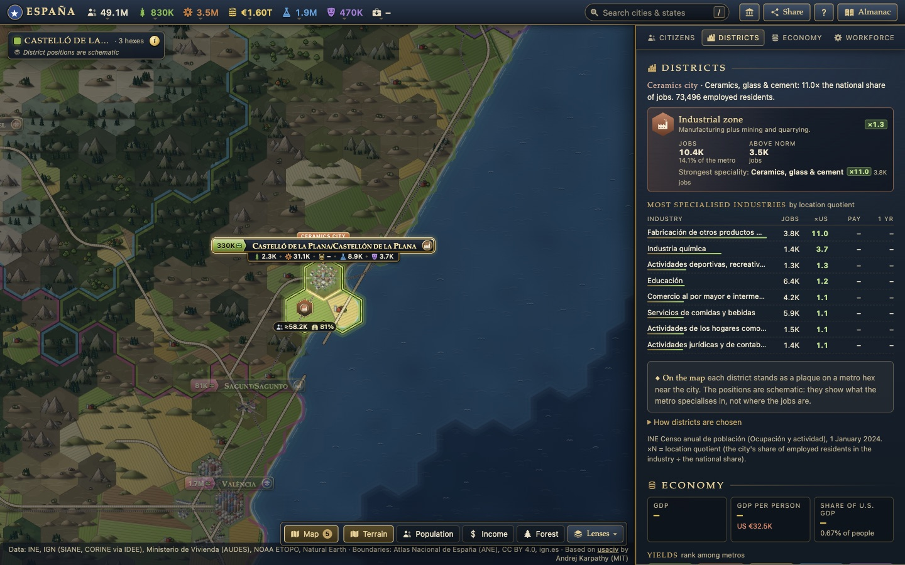
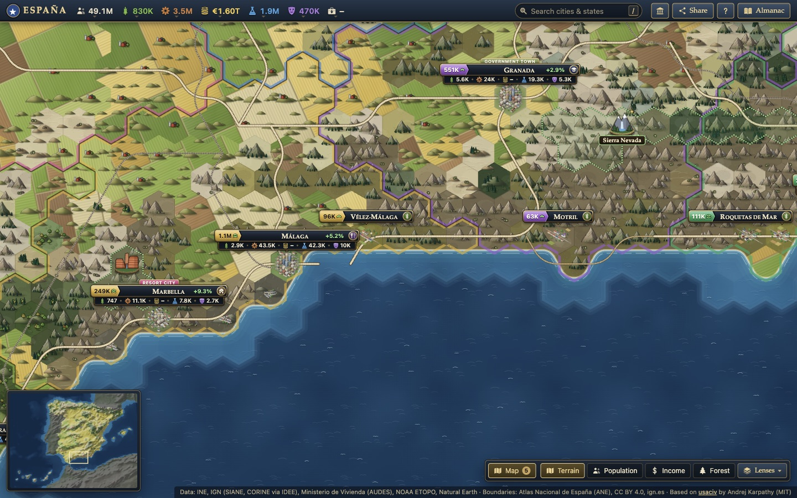

# spainciv: Spain as a strategy-game map, built from public data

**Live: [spainciv.djinnfoundry.com](https://spainciv.djinnfoundry.com/)** · A port to Spain of Andrej Karpathy's
[usaciv](https://karpathy.ai/usaciv/) (MIT). The US map still builds from this repository, byte for byte.


spainciv is an interactive map of Spain in the style of a turn-based strategy game. Terrain comes from elevation and
land-cover data, city banners show yields based on employment, and provincial GDP becomes Gold. The in-app Almanac
lists the public data behind the map.

<table>
  <tr>
    <td></td>
    <td></td>
  </tr>
  <tr>
    <td></td>
    <td></td>
  </tr>
</table>

## What's in it

- **The map**: 5,843 land hexes 10 km across, in an equal-area projection centred on Spain, with the Canary Islands in
  an inset. Relief from ETOPO1, land cover from CORINE 2018, the 52 provinces and 8,132 municipalities from the IGN's
  SIANE, rivers, motorways and railways.
- **Cities** are the 86 large urban areas of the Atlas Digital de las Áreas Urbanas (Madrid's has 52 municipalities and
  6.6 million people), like the US map's metro areas.
- **Yields**: Food, Production and Culture count employed residents by CNAE section (INE Annual Population Census);
  Science is R&D personnel (INE R&D statistic, by autonomous community, shared below it by the census Science
  workers); Gold is GDP (INE regional accounts), published down to provinces only.
- **Districts and city types** come from each city's industry specialisation against the national share: Castelló is a
  Ceramics city, Vigo and Valladolid are Motor cities.
- **Lenses**: population density, income, poverty and mean age (INE household income atlas), born abroad and higher
  education (INE Annual Population Census), homeowners (2021 Census), land cover, broadband coverage, commuting, life
  expectancy, home value per m² (by province), religious weddings (Spain has no religion census) and burnt area (EFFIS); heritage, museums, castles
  and bullrings (Wikidata), ancient peoples, languages, Blue Flag beaches; food denominations and regional dishes;
  Fiestas de Interés Turístico, bars per inhabitant (OpenStreetMap), tourist dwellings (INE) and this map's own
  party index.
- **Reservoirs**: the water in each basin week by week since 1988, from the Boletín Hidrológico (MITECO), with a ring
  per reservoir, the series' lowest and highest weeks and a year-by-year play
  ([#lens=embalses](https://spainciv.djinnfoundry.com/#lens=embalses&semana=1995-11-07)).
- **Wildlife**: where the Iberian lynx, brown bear, wolf, Spanish imperial eagle and bearded vulture were reported in
  2013-2018 (MITECO's 10 km grids for the EU Habitats and Birds Directive reports), with the latest lynx and wolf
  censuses beside them.
- **Wonders**: the 16 National Parks.
- **Play it**: the same Spain as a map for [Unciv](https://github.com/yairm210/Unciv), the open-source Civilization V
  (desktop and Android), with its real coast, relief, rivers and resources (wine where the wine denominations are,
  salt, marble and iron where the IGME lists workings). How to install it:
  [spainciv.djinnfoundry.com/play.html](https://spainciv.djinnfoundry.com/play.html).
- **Guess the hex**: a daily game on the map. Six clues from the map's data describe one 10 km hex; click where you
  think it is, with six tries, distance and direction after each, and a spoiler-free result to share; each win colours
  its province in an album of Spain's 50 provinces, community by community
  ([spainciv.djinnfoundry.com/#juego](https://spainciv.djinnfoundry.com/#juego)).
- **Spain to discover**: a fog of war (Map menu, "To discover") over the land you have not looked at yet. Hovering,
  clicking, searching and the daily game clear it while the switch is on, more land at a time the farther out the map is
  zoomed; a panel counts the share of Spain explored, by region too.

The map is in Spanish and English: it opens in the browser's language and a switch in the top bar changes it
(interface in `web/js/i18n/`, data texts in an English overlay next to each data file; see docs/SPAIN.md). The US
map keeps its English. What is still missing, and why, is in
[ROADMAP.md](ROADMAP.md): ports and airports, power plants, universities and the national-park visitor counts.

## Run it

You need [uv](https://docs.astral.sh/uv/). The pipeline is Python with the standard library only; the site is static
ES modules and Canvas 2D, with no npm and no build step.

```bash
uv run --locked python -m pipeline serve --country es  # Spain at http://127.0.0.1:8765, data included
uv run --locked python -m pipeline serve               # original United States map
uv run --locked python -m pipeline all --country es    # rebuild Spain, downloads ~730 MB of source data
uv run --locked python -m unittest discover -s tests   # Python tests and browser-module checks via Node
```

`pipeline/countries/` holds what makes a map one country or the other (projection, hex size, administrative levels,
currency); Spain's sources are in `pipeline/sources/es/` and its builders in `pipeline/build/spain*.py`. How the
original pipeline works is in [Karpathy's README](docs/USACIV.md); the data contracts are in
[docs/DATA_CONTRACTS.md](docs/DATA_CONTRACTS.md).

## Contribute

If you spot a map or data error, open a GitHub issue with the link from **Share → Copy link** and the source you used
to check it. For proposed datasets, include the publisher, licence and geographic coverage. See [ROADMAP.md](ROADMAP.md)
for the layers still missing.

## Sources and credits

Every Spanish source, with its licence, is listed in [docs/SPAIN.md](docs/SPAIN.md): INE (CC BY 4.0), the IGN's SIANE
and Atlas Nacional de España (CC BY 4.0), CORINE Land Cover via the IGN/IDEE (Copernicus), the Ministerio de Vivienda's
urban-area atlas, the OAPN's National Park boundaries, NOAA ETOPO1 and Natural Earth (public domain). The design
decisions and their reasons are in [DECISIONS.md](DECISIONS.md), the changes in [CHANGELOG.md](CHANGELOG.md), and the
bugs found in the original in [UPSTREAM.md](UPSTREAM.md).

The code is MIT-licensed, like usaciv: see [LICENSE](LICENSE) and [NOTICE](NOTICE). The original source is kept on the
`upstream` branch (tag `upstream-2026-11-26`). Built by [DjinnFoundry](https://djinnfoundry.com/).

## En castellano

spainciv dibuja la España real como el mapa de un juego de estrategia por turnos, con datos públicos: relieve,
cubierta del suelo, provincias y municipios del IGN, las 86 grandes áreas urbanas como ciudades, empleo por sector del
Censo del INE, PIB provincial, renta, carreteras, ferrocarril y los 16 Parques Nacionales. Es un port del
[usaciv](https://karpathy.ai/usaciv/) de Andrej Karpathy, con la misma licencia MIT. El mapa está en
[spainciv.djinnfoundry.com](https://spainciv.djinnfoundry.com/); las fuentes y sus licencias, en
[docs/SPAIN.md](docs/SPAIN.md), y lo que falta, en [ROADMAP.md](ROADMAP.md). El mapa está en castellano e inglés:
abre en el idioma del navegador y se cambia con un botón de la barra superior. El
mismo mapa se juega en Unciv, la versión libre de Civilization V:
[spainciv.djinnfoundry.com/jugar.html](https://spainciv.djinnfoundry.com/jugar.html). Cada día hay un juego en el
propio mapa, «Adivina el hexágono», con un álbum de provincias que se llena con cada acierto:
[spainciv.djinnfoundry.com/#juego](https://spainciv.djinnfoundry.com/#juego).
En el menú Mapa, «Por descubrir» cubre de niebla la España que aún no has explorado.
