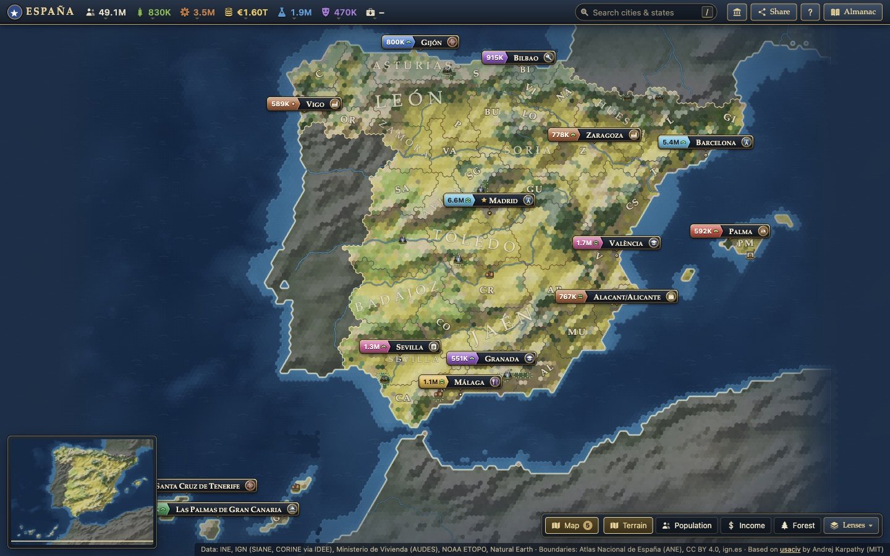
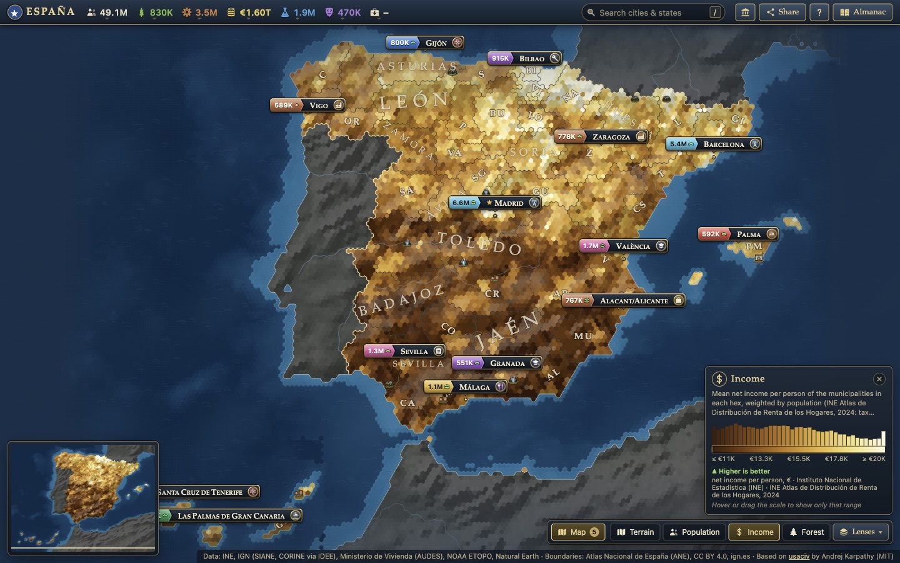

# spainciv: Spain as a strategy-game map, built from public data

**Live: [spainciv.djinnfoundry.com](https://spainciv.djinnfoundry.com/)** · A port to Spain of Andrej Karpathy's
[usaciv](https://karpathy.ai/usaciv/) (MIT). The US map still builds from this repository, byte for byte.



spainciv is an interactive map of Spain in the style of a turn-based strategy game. Terrain comes from elevation and
land-cover data, city banners show yields based on employment, and provincial GDP becomes Gold. The in-app Almanac
lists the public data behind the map.

<table>
  <tr>
    <td></td>
    <td></td>
  </tr>
  <tr>
    <td></td>
    <td></td>
  </tr>
</table>

## What's in it

- **The map**: 5,843 land hexes 10 km across, in an equal-area projection centred on Spain, with the Canary Islands in
  an inset. Relief from ETOPO1, land cover from CORINE 2018, the 52 provinces and 8,132 municipalities from the IGN's
  SIANE, rivers, motorways and railways.
- **Cities** are the 86 large urban areas of the Atlas Digital de las Áreas Urbanas (Madrid's has 52 municipalities and
  6.6 million people), like the US map's metro areas.
- **Yields**: Food, Production and Culture count employed residents by CNAE section (INE Annual Population Census);
  Science is R&D personnel (INE R&D statistic, by autonomous community, shared below it by the census Science
  workers); Gold is GDP (INE regional accounts), published down to provinces only.
- **Districts and city types** come from each city's industry specialisation against the national share: Castelló is a
  Ceramics city, Vigo and Valladolid are Motor cities.
- **Lenses**: population density, income (INE household income atlas) and land cover; heritage, museums, castles
  and bullrings (Wikidata), ancient peoples, languages, Blue Flag beaches; food denominations and regional dishes;
  Fiestas de Interés Turístico, bars per inhabitant (OpenStreetMap), tourist dwellings (INE) and this map's own
  party index.
- **Wonders**: the 16 National Parks.

The interface is in Spanish (`web/js/i18n/`; the US map keeps its English). What is still missing, and why, is in
[ROADMAP.md](ROADMAP.md): ports and airports, power plants, universities and the national-park visitor counts.

## Run it

You need [uv](https://docs.astral.sh/uv/). The pipeline is Python with the standard library only; the site is static
ES modules and Canvas 2D, with no npm and no build step.

```bash
uv run --locked python -m pipeline serve --country es  # Spain at http://127.0.0.1:8765, data included
uv run --locked python -m pipeline serve               # original United States map
uv run --locked python -m pipeline all --country es    # rebuild Spain, downloads ~730 MB of source data
uv run --locked python -m unittest discover -s tests   # Python tests and browser-module checks via Node
```

`pipeline/countries/` holds what makes a map one country or the other (projection, hex size, administrative levels,
currency); Spain's sources are in `pipeline/sources/es/` and its builders in `pipeline/build/spain*.py`. How the
original pipeline works is in [Karpathy's README](docs/USACIV.md); the data contracts are in
[docs/DATA_CONTRACTS.md](docs/DATA_CONTRACTS.md).

## Contribute

If you spot a map or data error, open a GitHub issue with the link from **Share → Copy link** and the source you used
to check it. For proposed datasets, include the publisher, licence and geographic coverage. See [ROADMAP.md](ROADMAP.md)
for the layers still missing.

## Sources and credits

Every Spanish source, with its licence, is listed in [docs/SPAIN.md](docs/SPAIN.md): INE (CC BY 4.0), the IGN's SIANE
and Atlas Nacional de España (CC BY 4.0), CORINE Land Cover via the IGN/IDEE (Copernicus), the Ministerio de Vivienda's
urban-area atlas, the OAPN's National Park boundaries, NOAA ETOPO1 and Natural Earth (public domain). The design
decisions and their reasons are in [DECISIONS.md](DECISIONS.md), the changes in [CHANGELOG.md](CHANGELOG.md), and the
bugs found in the original in [UPSTREAM.md](UPSTREAM.md).

The code is MIT-licensed, like usaciv: see [LICENSE](LICENSE) and [NOTICE](NOTICE). The original source is kept on the
`upstream` branch (tag `upstream-2026-11-26`). Built by [DjinnFoundry](https://djinnfoundry.com/).

## En castellano

spainciv dibuja la España real como el mapa de un juego de estrategia por turnos, con datos públicos: relieve,
cubierta del suelo, provincias y municipios del IGN, las 86 grandes áreas urbanas como ciudades, empleo por sector del
Censo del INE, PIB provincial, renta, carreteras, ferrocarril y los 16 Parques Nacionales. Es un port del
[usaciv](https://karpathy.ai/usaciv/) de Andrej Karpathy, con la misma licencia MIT. El mapa está en
[spainciv.djinnfoundry.com](https://spainciv.djinnfoundry.com/); las fuentes y sus licencias, en
[docs/SPAIN.md](docs/SPAIN.md), y lo que falta, en [ROADMAP.md](ROADMAP.md). La interfaz está en castellano.
